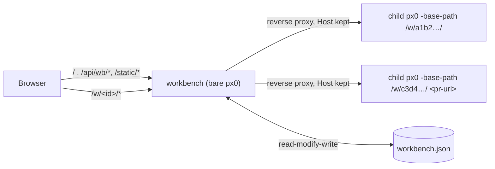

# Workbench Internals

The workbench (`workbench.go`, `web/workbench.{html,css,js}`) is what `px0` serves when started without a target. It is a supervisor and reverse proxy, not a multi-workspace server: every directory or pull request it opens runs as a separate child px0.

## Why child processes

`Server` is built around a single workspace: one `Index`, `lspManager`, `agentManager`, `prSession`, `GitWatcher` and `diffBase`, all fixed in `main()`. Rather than threading a workspace ID through every handler, the workbench re-runs the px0 binary per workspace. Each child keeps px0's single-workspace performance, a crashing or memory-hungry language server only takes down its own child, and stopping a child frees everything it held.



## Children

### Existing worktree navigation

The default UI now reviews worktrees in place. `GET /api/git/worktrees/changes`
and `GET /api/git/worktrees/diff` accept a registered `worktree` path, and the
diff endpoint additionally requires a currently changed `path` and `group`
(and `from` for a rename). Diff validation runs path-scoped status, rather than
rescanning the entire checkout for every file selection.
`worktree_changes.go` reads porcelain-v2 status with NUL-delimited paths,
distinguishes index and working-tree changes, disables external diff drivers,
and limits Git processes to ten seconds and 2 MiB output. File paths and their
nearest existing ancestors are confined to the selected checkout. These reads
do not replace `Server.ix`, change branches, write Git state, or launch children.

`worktreechanges.js` owns the Changes surface. Its independent controller
aborts obsolete reads, rejects stale responses, and keeps a bounded cache of
selected files/diffs/scroll positions. The editor DOM is hidden rather than
rebooted; its tabs, unsaved edits, and streams retain their original workspace.
Read-only diff rows have no editor line targets. Each checkout has an independent
expandable section, so several change lists can stay visible. Hidden/expanded
preferences, display-name aliases keyed by checkout path, and the last inventory
are stored in browser localStorage; hiding
never removes Git worktrees or files. Renaming only updates that preference;
it does not move directories, rename branches, or issue Git requests. Labels
are rendered as escaped text and shared with the command palette. Only expanded,
visible sections refresh
status (ten-second cache, maximum two concurrent scans). Only the active diff
refreshes every two seconds. Rendering is paged for both files and diff rows.

The earlier full-workspace opening API remains available for existing workspace
URLs; the Changes list and palette no longer navigate to those URLs.

`worktrees.go` exposes `GET /api/git/worktrees` and same-origin
`POST /api/git/worktrees/open`. Discovery runs `git worktree list --porcelain -z`
with terminal prompts disabled; NUL-delimited fields preserve whitespace and
quoted filenames. `?all=1` includes the current repository and known directories
from the existing workbench recent list. Git common-directory identity deduplicates
linked checkouts. Inventory builds have a three-second budget and a shared
fifteen-second cache; concurrent callers share one build. `?refresh=1` bypasses
the cache. This works from a non-Git folder without recursively scanning home
or unignoring the file index. The open endpoint accepts only a currently
registered, available checkout of the viewer's repository.

Workbench children record the selected directory in the shared store and return
its existing `/w/<id>/` URL. Standalone viewers lazily reuse `workbench` for
child launch/proxy only, exposing `/w/<id>/` exclusively for the repository's
registered worktrees. The unrestricted workbench browse/open APIs are not
exposed by a standalone viewer. Worktree children use the internal
`-worktree-host` flag and `meta.worktreeHost` to return to their original viewer,
keeping `meta.workbench` reserved for a full workbench. Returning to the original
checkout redirects to its existing viewer instead of starting a duplicate.
The normal child flags are inherited, and `CloseWorktrees` stops these children
when the standalone host shuts down. Idle children use the usual workbench
reaping policy.

### Child process protocol

`workbench.start` runs:

```
px0 [passed-on flags] -workbench-child -host 127.0.0.1 -port 0 -no-open -no-update -no-color -base-path <wb>/w/<id>/ <dir | pr-url>
```

- **Readiness.** With `-workbench-child`, `main` prints `px0-ready <addr>` once it is listening. The workbench reads child output through `lineWriter`, which also drops spinner frames (`\r`), and keeps the last 20 lines; `wbChild.failure` reports the last `px0: …` line as the error.
- **Lifetime.** The workbench holds the child's stdin. The child treats EOF on stdin as SIGTERM and shuts down the normal way, which removes PR worktrees and stops language servers. This works if the workbench is stopped, crashes or is killed, on every platform. `stop` closes stdin and kills the child after 5 seconds. `cmd.WaitDelay` keeps a grandchild holding the output pipes from blocking `Wait`.
- **States.** `starting` → `running` → `stopped`, or `failed` if the child exits before it is ready or takes longer than `wbStartTimeout` (3 minutes; a PR may clone a large repository). Live state is kept only in memory and never written to `workbench.json`.
- **Idle stop.** The proxy counts requests in flight per child; an open tab always holds an event stream. `reapIdle` stops children with none in flight for `wbIdleAfter` (30 minutes).
- **PR clones.** `checkoutPR` makes a worktree when its working directory is a clone of the PR's repository, so the workbench starts every PR child in one (see below). Before the child is launched, `run` resolves the clone, or makes one, while the state is `starting` and `progress` says what it is waiting on. `stop` cancels this through `wbChild.ctx`.

## PR clones ([`workbench.go`](../../workbench.go))

Every PR is a worktree of one local clone per repository; nothing is cloned per PR.

- **Matching.** `findPRRemote(dir, owner, repo)` (pr.go) returns the clone's top level and the name of the remote that points at the repository. It checks `origin` first, then `upstream` (a fork), then any other remote. `remoteMatchesRepo` compares the parsed `owner/repo` of https, ssh and scp-style URLs exactly, ignoring case. The old check, a substring test on `origin`, matched `px0` against `px0-docs`. `checkoutPR`, `computeDiffBase` and `Pull` fetch from that remote rather than assuming `origin`. An empty remote name still means `origin`.
- **Finding.** `findClone` tries `knownClone` first: the clone remembered in `workbench.json` (`clones`, keyed by lowercased `owner/repo`), then the recorded directories, then the workbench's cwd. Failing that, `scanForClone` searches the usual code folders under home and the parents of recorded directories, breadth-first, three levels deep. It skips hidden and dependency folders, looks at no more than 20,000 entries and gives up after 1.5 seconds, and it only considers folders named like the repository that hold a `.git`. A clone found this way is remembered.
- **Asking.** `/api/wb/open` checks for a clone before it records a PR. With none, it returns `{needClone, repo, managed}` and the page asks. The next request passes `clone`, either a folder (verified with `cloneOf`, then remembered) or `"managed"`.
- **px0's own clone.** `makeClone` clones once into `<state>/repos/<owner>/<repo>`, as a partial clone (`--filter=blob:none`) with no checkout of its own. It clones into a sibling temp folder and renames it into place, so an interrupted clone never looks finished. A per-repository mutex keeps two PRs opened together from cloning twice.
- **Credentials.** `gitLocalThenToken` runs the head fetch and `worktree add` with the clone's own git credentials first, and with the GitHub token only if that fails. A partial clone fetches file contents during `worktree add`, which a private repository's token covers. A user's clone may have broader access than the token, so its credentials go first.
- **Reopening.** A recent PR reopened from its holding page whose clone has disappeared fails with `errNoClone`. The holding page then offers **Choose a clone**, which links to the workbench with `?open=<url>`.
- **CLI.** `main` passes `knownClone`'s result (memory and recorded directories, no scan) to `checkoutPR` when `px0 <pr-url>` runs outside a matching clone.

## Proxy

`/w/<id>/…` goes to the child's `httputil.ReverseProxy`, which has `FlushInterval: -1` so event streams are not buffered. The proxy keeps the browser's `Host` header (`pr.Out.Host = pr.In.Host`), so the child's `localPost` check, which compares `Host` with `Origin`, still passes. The child serves under its own base path, and its `/api/meta` reports `workbench`, the workbench's base path. The frontend uses it for the back link and to send **Git: Open Pull Request…** to `/api/wb/open` instead of `/api/pr/launch`.

If the child is not running, a GET of the workspace page itself (`/w/<id>/`) starts it and returns a holding page. The page refreshes every second until the child is ready, or shows the error. Other paths return 503. This is why a bookmarked or reloaded workspace reopens, and why the workbench page can use plain links for known items.

## Page

`web/workbench.html` is driven by `web/src/workbench.js`, a second bundle entry in `scripts/build-web.js` (output `web/workbench.js`, gitignored like `app.js`). It imports only `state.js`, `theme.js` and `metricsview.js`. `metricsview.js` holds the status bar's metrics chip and menu, moved out of `status.js` so both pages share them. The menu lists `parts` when a payload has them. The workbench's `/api/metrics` sums its own process with each running child's `/api/metrics`, fetched directly rather than through the proxy so the polling does not count against idle stop, and returns the parts for the menu. `/api/settings` on the workbench only accepts `workbench.colorTheme`, which `theme.js`'s `setTheme` posts. `/api/wb/complete?q=` lists folders whose names start with `q`'s last path element (case-insensitive), spelled the way `q` spells its parent (`~/`, relative) so the input does not jump.

## Item IDs

`wbItemID` is the first 6 bytes, as hex, of the SHA-256 of the kind plus a key: the cleaned absolute path for a directory, or the lowercased `provider/owner/repo#n` for a pull request. The ID is stable, so `/w/<id>/` is stable. A PR's review drafts are saved in a session file named after the same ID (`prSessionFilePath`), so they survive a reopen, from the workbench or from `px0 <pr-url>`, even though each opening checks the PR out into a new temporary directory.

## Store

`wbStore` keeps nothing in memory. Each change re-reads `workbench.json`, applies the change, trims the list (pinned entries plus the 50 most recent) and writes it back atomically (temp file + rename). A plain `px0 <dir>` or `px0 <pr-url>` records itself through `recordRecent`, so the workbench must not overwrite entries it never loaded. An unparseable file is renamed to `workbench.json.bad` rather than overwritten.

An item added by `/api/wb/open` that fails before its child is ready is removed again (`forget`), so a mistyped URL does not stay in the list. The holding page still shows the error from the in-memory child.

## Single instance

`workbench.lock`, next to `workbench.json`, records the workbench's PID and loopback URL. A second bare `px0` pings `/api/wb/ping` there and opens the browser on the existing workbench if it answers. Only the process that wrote the lock removes it.

## Security

`/api/wb/browse` and `/api/wb/complete` list folders anywhere on disk, and `/api/wb/open` can start a workspace on any of them. Requests that change anything go through `localPost`: POST only, with a `Host` that is an IP address or localhost, and an `Origin` that matches it. GET requests for state and folder listings, and requests to start a workspace, go through `trustedGet`, which applies the same `Host` check against DNS rebinding. Children bind only to 127.0.0.1 and can be reached only through the proxy. When bound to a non-loopback address, the workbench prints a warning that anyone who can reach it can browse the machine.

### Worktree writes and terminals

`worktree_stage.go` accepts same-origin POST requests with an explicit registered
checkout, group, and file (or all=true). It validates literal paths against fresh
status, serializes index writes, handles rename sources and unborn HEAD, and
refreshes only affected paths for single-file actions. The frontend cancels stale
reads and merges scoped updates; other checkouts' state remains independent.

`terminal.go` lazily creates PTY shells, at most 16 across checkouts. Opening a
checkout reuses a live session, while POST open with new=true always creates
a distinct shell. Per-checkout counters label duplicates and a global creation
sequence keeps the restored list ordered. An authenticated rename action stores
a 120-character optional name on the session; empty names restore the default.
`creack/pty` provides Unix terminal allocation/resizing; Windows returns a clear
unsupported response. All terminal APIs require loopback + same-origin POST, and
session I/O requires an unguessable capability in the JSON body. Output uses a
bounded 256 KiB ring and authenticated POST NDJSON stream with write deadlines.
Disconnecting a browser leaves the shell running; reconnecting replays retained
output. Shutdown and explicit close hang up PTYs and reap shells. No command
transcripts are saved by px0; the user's shell retains its usual history policy.

`terminal.js` loads pinned embedded xterm assets on demand, bounds scrollback to
2,000 lines, awaits render writes, serializes input, fits the panel, and isolates
terminal keystrokes from editor shortcuts. There is no mandatory tmux process or
runtime dependency. Authentication tokens are never put in request URLs.

The terminal panel docks inside `.wt-main` in Changes mode and returns to the
editor column in Code/Review mode. Moving its existing DOM preserves xterm buffers
and shell identity. A vertical tab list replaces the session selector, with arrow
key navigation. A pointer/keyboard separator resizes the panel and saves its height
in localStorage, clamping on window or mode changes to leave space for the editor.
`terminal-layout.js` derives xterm colors from the active CSS palette, applying a
12-percent neutral-grey blend to the editor background. Theme changes update
existing terminals without recreating their shells or buffers.

Terminal rename and close controls are siblings of each session tab, with explicit
session IDs. Closing an inactive row preserves the active terminal and stream;
closing the last row hides the panel. The session list remains visible for a
single terminal. The toolbar contains only new/hide controls; Ctrl-C forwards
interrupts directly. Worktree status text is reserved for errors and empty-state
explanations, with the routine worktree count/expand hint omitted.
